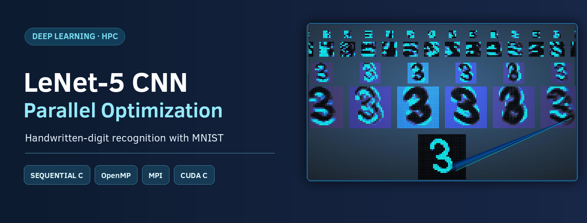
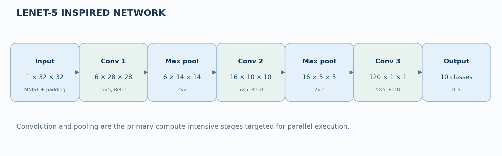
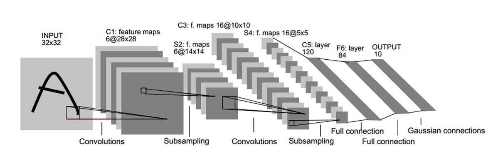
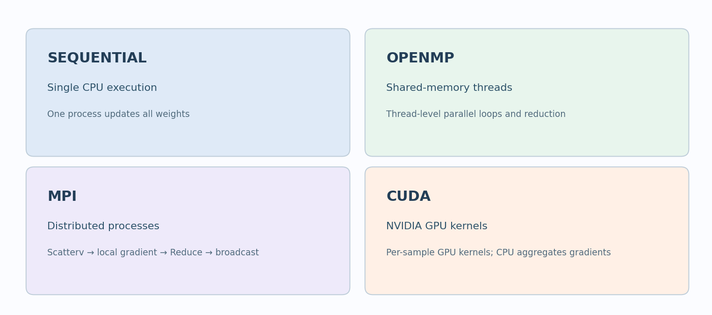
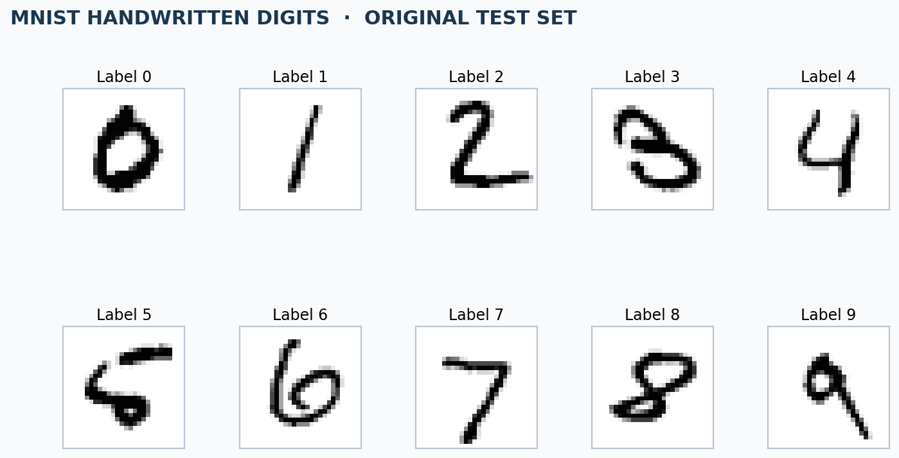
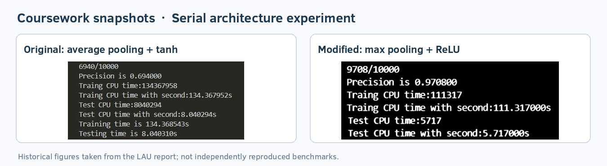

# LeNet-5 CNN | Parallelization & Performance Optimization

**Parallel implementation and performance optimization of a convolutional neural network for handwritten-digit recognition using C, OpenMP, MPI, and CUDA.**

**Project areas:** Deep Learning · Computer Vision · Parallel Programming · High-Performance Computing  
**Technologies:** C · OpenMP · MPI · CUDA C/C++ · MNIST · GNU Make  
**Academic context:** Lebanese American University (LAU) · Parallel Programming and Multi-Cluster Systems



## Overview

Convolutional neural networks (CNNs) are widely used for image classification and recognition tasks. However, training and evaluating CNNs involves computationally intensive operations, including convolutions, pooling, forward propagation, backpropagation, and parameter updates.

This project explores **parallel computing techniques to optimize the execution of a LeNet-5-inspired CNN** for handwritten-digit classification using the MNIST dataset.

Four implementation approaches are investigated:

- **Sequential C:** Establishes a baseline for CNN training and inference.
- **OpenMP:** Accelerates computation through shared-memory multithreading on CPUs.
- **MPI:** Distributes training and testing workloads across multiple processes.
- **CUDA C:** Uses GPU parallelism to accelerate training and inference operations.

The project focuses on comparing different parallelization strategies, investigating computational bottlenecks, and analyzing trade-offs between execution time, scalability, and classification accuracy.

## Neural Network Architecture



The CNN follows a modified LeNet-5 architecture designed to classify handwritten digits into ten categories (0–9). The diagram above illustrates the LeNet-5 network structure; the implementation uses **ReLU activations and max pooling**, with the layer dimensions listed below.

MNIST input images are 28 × 28 grayscale images, padded to 32 × 32 before processing. The implementation consists of three convolutional stages, two max-pooling stages, and a final fully connected classification layer.

| Layer | Output Dimensions | Operation |
|---|---|---|
| Input | 1 × 32 × 32 | Image normalization and zero padding |
| Convolution 1 | 6 × 28 × 28 | 5 × 5 convolution, ReLU |
| Max Pooling 1 | 6 × 14 × 14 | 2 × 2 downsampling |
| Convolution 2 | 16 × 10 × 10 | 5 × 5 convolution, ReLU |
| Max Pooling 2 | 16 × 5 × 5 | 2 × 2 downsampling |
| Convolution 3 | 120 × 1 × 1 | 5 × 5 convolution, ReLU |
| Output | 10 | Fully connected classification |


## Parallelization Strategies



The CNN was implemented using four computing approaches to explore different forms of parallel execution.

### 1. Sequential CPU Implementation

The sequential implementation executes CNN operations on a single CPU process, including image preprocessing, forward convolution, pooling, fully connected classification, backpropagation, mini-batch training, and model evaluation. It provides the reference execution time for analyzing the parallel approaches.

### 2. OpenMP — Shared-Memory Parallelism

OpenMP distributes computational workloads across CPU cores. Optimization targets include parallel batch processing with synchronized gradient aggregation, input normalization using reductions, convolution and feature-map calculations, backpropagation, parameter updates, and inference across multiple test images.

OpenMP directives such as `#pragma omp parallel for`, `reduction`, and `critical` coordinate execution and manage shared data.

### 3. MPI — Distributed-Memory Parallelism

MPI distributes CNN training and evaluation across multiple processes. Each process receives a subset of data, performs local forward and backward propagation, and contributes to global parameter updates.

The implementation uses:

- `MPI_Scatterv` to distribute data across ranks, including uneven partitions.
- `MPI_Reduce` to aggregate computed gradients.
- `MPI_Bcast` to synchronize updated model parameters.
- Distributed inference across MPI ranks.

This approach explores communication overhead, workload distribution, and process coordination.

### 4. CUDA — GPU Parallel Computing

CUDA uses NVIDIA GPUs for parallel execution of training and inference workloads. The implementation explores GPU batch-processing kernels, parallel inference, kernel scheduling, memory allocation, and host-device data transfers. The supplied training implementation aggregates computed gradients on the CPU.

## Dataset — MNIST

The project uses the **MNIST handwritten-digit dataset**, a standard benchmark for image classification.

| Property | Description |
|---|---|
| Training images | 60,000 |
| Testing images | 10,000 |
| Image size | 28 × 28 pixels |
| Image format | Grayscale |
| Classes | Digits 0–9 |



### Dataset Setup

To keep the repository lightweight, the dataset is downloaded separately and shared across all four implementations.

```bash
python3 scripts/download_mnist.py
python3 scripts/verify_dataset.py
```

The files are stored locally under `data/mnist/`. The download script uses the [CVDF MNIST mirror](https://github.com/cvdfoundation/mnist). Alternatively, extract the optional offline dataset bundle into the repository root; see [`data/README.md`](data/README.md).

## Experiments and Performance Analysis

The experiments investigate how architectural choices and parallel execution strategies affect CNN performance.

### Activation Functions and Pooling

Two network configurations were investigated: **Average Pooling + Tanh** and **Max Pooling + ReLU**. The experiments examined their classification performance and execution times.



The recorded experiments favored **Max Pooling + ReLU**, which was adopted for the parallel implementations. Because the activation and pooling choices affect the network itself, their timings should not be interpreted as isolated parallel-computing speedups.

### Parallel Execution

| Approach | Execution Model | Main Optimization Focus |
|---|---|---|
| Sequential | Single CPU process | Baseline execution |
| OpenMP | Multithreaded CPU | Shared-memory parallelism |
| MPI | Multiple processes | Workload distribution and gradient aggregation |
| CUDA | NVIDIA GPU | GPU kernels and parallel computation |

Performance evaluation considers **training time, inference time, classification accuracy, speedup, parallel efficiency, and scalability**. The experiments also explore synchronization overhead, communication costs, memory access, and workload balance.

## Build and Run

**Recommended environment:** Linux or Windows with WSL2. Run the commands from the repository root after preparing the MNIST dataset.

### Sequential Implementation

```bash
make -C seq
./seq/lenet5
```

### OpenMP Implementation

```bash
make -C omp
OMP_NUM_THREADS=4 ./omp/lenet5
```

Set `OMP_NUM_THREADS` to compare different thread counts.

### MPI Implementation

```bash
make -C mpi
mpirun -np 4 ./mpi/lenet5
```

Set `-np` to change the number of MPI processes. Requires Open MPI or MPICH.

### CUDA Implementation

```bash
make -C cuda
./cuda/lenet5
```

Requires the NVIDIA CUDA Toolkit and a compatible GPU.

### Quick Test

To check the sequential and OpenMP implementations on small workloads:

```bash
bash scripts/quick_test.sh
```

This verifies the dataset, builds the two variants, and runs training and inference using 300 training images and 100 test images. Accuracy on this small subset is not a meaningful full-MNIST benchmark.

### Cleaning Build Files

```bash
make -C seq clean
make -C omp clean
make -C mpi clean
make -C cuda clean
```

## Reproducibility

The repository includes the source code, build instructions, dataset preparation scripts, and supporting documentation. Sequential and OpenMP were compiled and smoke-tested with GCC. MPI multi-process and CUDA GPU runs require appropriate runtimes/hardware and have not been independently verified in this packaging environment.

For valid comparisons, use consistent datasets, training schedules, build optimization settings, and documented hardware. Historical coursework timings can vary by environment and should be distinguished from independently reproduced benchmarks. Additional notes are in [`docs/notes/maintenance.md`](docs/notes/maintenance.md).

## Repository Structure

```text
LeNet5-CNN-Parallel-Optimization/
├── README.md
├── ACKNOWLEDGMENTS.md
├── seq/                   Sequential C implementation
├── omp/                   OpenMP implementation
├── mpi/                   MPI implementation
├── cuda/                  CUDA GPU implementation
├── data/
│   ├── README.md
│   └── mnist/             Local MNIST data (Git-ignored)
├── scripts/               Dataset download, verification, smoke tests
└── docs/
    ├── images/            Network and experimental visuals
    ├── notes/             Implementation and reproducibility notes
    └── original-lau-report-redacted.pdf
```

## Project Report

The [LAU Final Project Report](docs/original-lau-report-redacted.pdf) provides additional architecture, implementation, and experiment details.

## Acknowledgments

 See [ACKNOWLEDGMENTS.md](ACKNOWLEDGMENTS.md) for contributors, original sources, MNIST credit, and distribution considerations.
